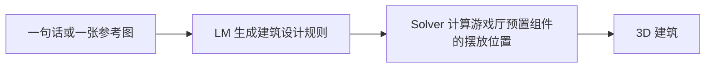
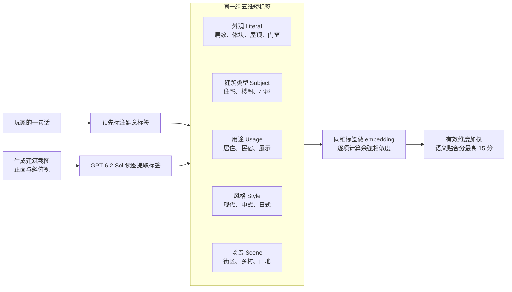
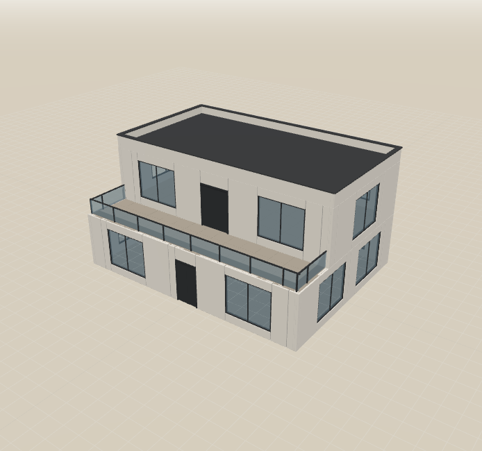
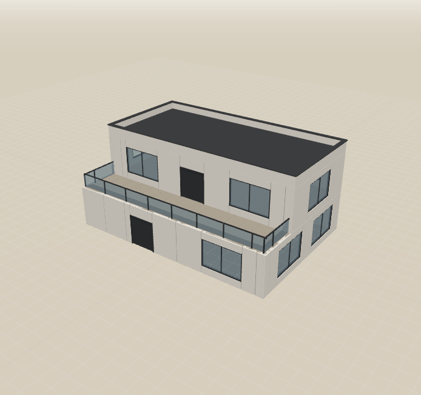
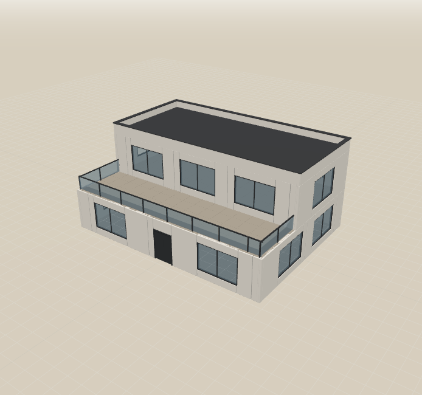
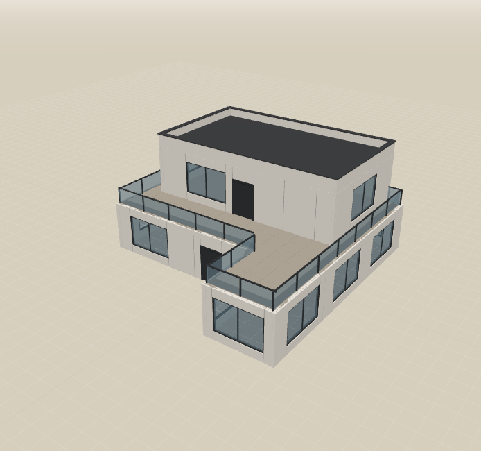
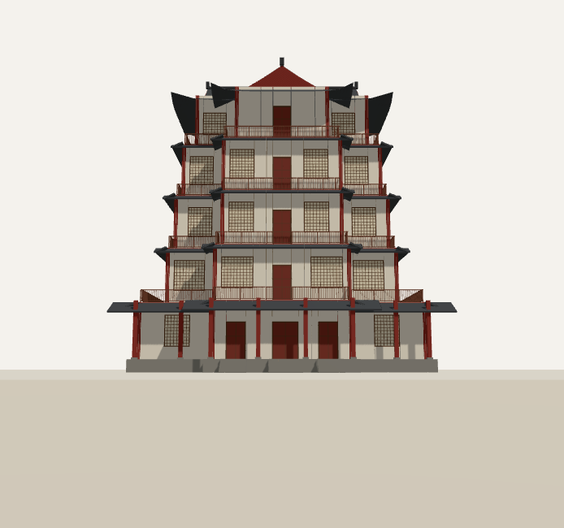
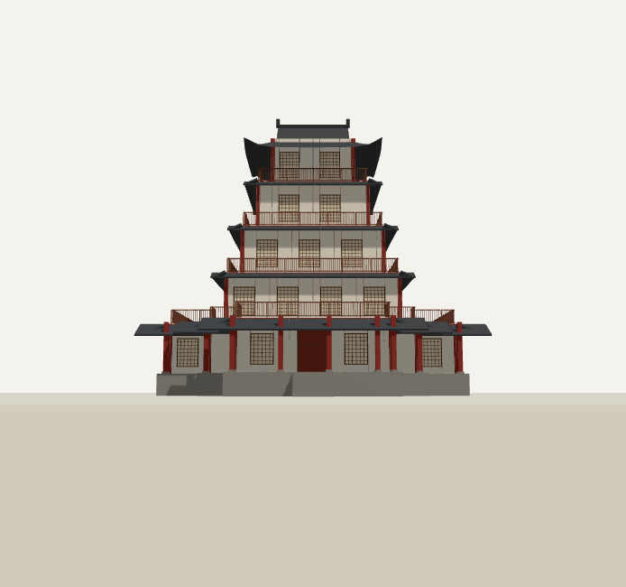
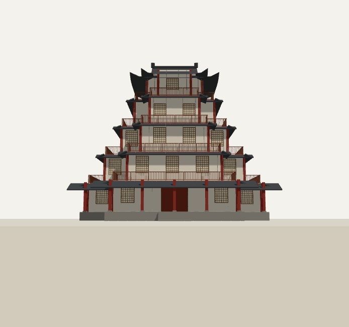
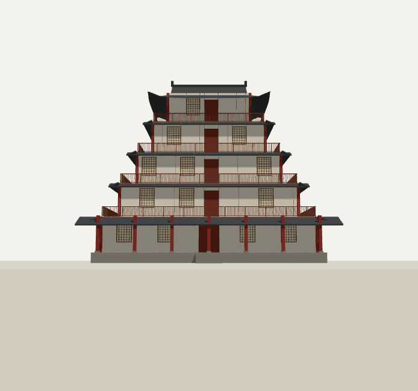

# UGC 建筑生成 Agent 评测

## 1. 场景与需求

UGC 建造面向没有专业建模经验的玩家和创作者。玩家只需输入**一句话或上传一张参考图**，就能生成可放进游戏、也可继续编辑的 3D 建筑。

**建筑必须使用游戏厅已有的预置组件拼装。** 从提交到显示可用建筑的时间越短越好。

### 1.1 建筑生成流程

例如，玩家说「建一栋两层平顶小屋，门开在南面」。LM 将需求写成「两层、平顶、首层南门」等设计规则，Solver 据此算出墙、门、楼板和屋顶放在哪里，供网页拼装成 3D 建筑。

## 2. 评测设计思路

四项分别判断建筑能否落地、是否符合玩家意图、设计是否协调，以及是否还原了地标特征。

### 2.1 规则校验（客观）

用程序检查建筑是否可用。例如，入户门落在两个体块的相接边上，就不算有效外门。其他检查包括 JSON 格式、预置组件 ID、占地越界、同层连通和上层支撑。

### 2.2 建筑贴合度（主观）

玩家通常只写一句话，截图描述却容易写成长段，还会带上玩家没提到的细节。把两边拆成同一组短标签，再用 embedding 逐维比较含义，就能让玩家的每个要求对上成品里对应的特征。

例如，玩家只说「两层平顶」，就用外观标签比较楼层和屋顶。计分只纳入题意明确、且从产物可判断的维度。

### 2.3 建筑美感（主观）

Sol 对比同题的匿名产物截图，衡量体块比例、门窗节奏、屋顶与主体是否协调，以及风格是否统一。

### 2.4 真实建筑还原（客观与主观结合）

用检查表核对关键构件及其位置，再由 Sol 对照参照，判断轮廓、体块比例和立面关系。参考图题用接近原图角度的主视图，比较预置组件能表达的建筑特征。

### 2.5 两组评分一览

#### 文字输入（100 分）

1. **规则校验（30 分）**，检查 JSON、预置组件、几何和开口是否合法。
2. **建筑贴合度（25 分）**，看成品语义和具体构件是否符合玩家描述。
3. **建筑美感（20 分）**，看体块比例、门窗节奏、屋顶协调和风格一致性。
4. **地标还原（25 分）**，核对地标的关键构件、轮廓和比例。

普通建筑题计前三项，地标题计第四项。

#### 参考图输入（100 分）

1. **规则校验（30 分）**，沿用文字组的检查，确认产物可以用游戏厅的预置组件拼装。
2. **照片还原（70 分）**，由 Sol 对照参考图和接近同角度的产物主视图。
   - **轮廓与比例（25 分）**，看整体高宽、外轮廓和对称关系。
   - **体块与屋顶（25 分）**，看主次体块、楼层层次和屋顶形态。
   - **立面与标志特征（20 分）**，看门窗位置、重复节奏和标志性构件。

## 3. 分组与计分

| 测试组 | 输入 | 检测目标 | 题量 |
|---|---|---|---:|
| 文字组 | 一句建筑需求或地标名称 | 指令遵循、建筑美感、从名称还原地标 | 5 道普通建筑题 + 5 道地标题 |
| 多模态组 | 一张参考图和一句建造指令 | 从图中读出结构，并建成可用、可辨认的建筑 | 5 道参考图题 |

两组均比较混元 HY4、HY4 Flash、DeepSeek Flash 和 GPT‑6.2 Astra。GPT‑6.2 Sol 负责解读截图和匿名评分。每题同组模型使用相同输入、系统提示词和求解器，最多一次生成、两次按错误反馈修复。输出包括可解析的设计 JSON、预制件摆放清单、主视图，以及判断空间关系所需的辅助视图。 [求解器](house-gen-demo/solver.js)

综合分取文字组和多模态组的等权平均。两个输入方式各占一半，分组成绩同时列出。正式产品的速度口径是从提交到可用建筑显示。本轮脚本分阶段生成和渲染，记录模型调用、必要修复和求解的耗时，速度仅作参考。

### 3.1 文字组评分

| 检测项 | 计分题集 | 满分 | 评分方式 |
|---|---|---:|---|
| 规则校验 | 普通建筑 | 30 | 首轮 JSON 格式 4 分，最终几何合法性 12 分，开口错误和自动修正 8 分，达到零错误的轮次 6 分。 |
| 建筑贴合度 | 普通建筑 | 25 | 要求命中率 10 分，按维度计算的语义相似度 15 分。 |
| 建筑美感 | 普通建筑 | 20 | 四项各 1–5 分。1 分表示明显失衡，3 分表示关系清楚，5 分表示组织协调。 |
| 地标还原 | 地标名称还原 | 25 | 机检按命中率给 15 分。Sol 对轮廓、体块、屋顶、立面和标志特征各评 0–2 分，共 10 分。 |

规则校验检查 1–6 层、每个矩形宽深至少 4 格、占地位于 80 × 80 格场地内、同层连通、上层有支撑，以及首层入户门和其他开口合法。每项评分先在对应题集内取均分，再合成文字组 100 分。贴合度的外观、类型、用途、风格、场景初始权重依次为 25%、20%、15%、30%、10%，按输入中明确且可观察的维度重新归一。

### 3.2 多模态组评分

1. **规则校验（30 分）**，按文字组的规则分计算。
2. **照片还原（70 分）**，按第 2.5 节的三个维度计分。每维两个检查点，各给 0 分（缺失或明显不符）、1 分（可辨但有偏差）或 2 分（匹配）。两项得分之和除以 4，再乘该维满分。

每题将两步得分相加，取五题平均作为多模态总分。

## 4. 文字用例

每题的输入是表中完整提示词。输出需通过求解器，且每行的验收项全部命中，才记该题完成。普通题可按机检需求区分相似但不合格的方案，地标题另看整体识别特征。

### 4.1 普通建筑

| 题号 | 输入全文 | 输出验收标准 | 为什么选这题 |
|---|---|---|---|
| T01 | 一座两层现代住宅，平屋顶，南面入户，二层向北收进，在南边留带栏杆的露台。 | 现代风、两层、平顶、首层南门、二层南缘退台且有南侧栏杆。 | 检测方向与楼层联动，避免只生成一个外观近似的两层房。 |
| T02 | 一座三层中式楼阁，歇山顶，正门在南边，顶层不开窗。 | 中式、三层、歇山顶、首层南门、顶层实际窗数为零。 | 检测禁窗要求能否作用于指定楼层。 |
| T03 | 一栋单层欧式住宅，平面是 L 形，双坡屋顶，在东侧开入户门。 | 欧式、单层、实际占地恰有一个矩形角缺口、双坡顶、首层东门。 | 检测模型能否将形状词落实到占地，也能区分转角结构和立面凸起。 |
| T04 | 一栋单层北欧小屋，矩形平面，双坡屋顶，北边开门，整栋不要窗。 | 北欧、单层矩形占地、双坡顶、首层北门、实际窗数为零。 | 检测全局禁窗和北向开门，约束模型的常见默认布置。 |
| T05 | 一座单层日式民宿，四面房屋围出封闭的露天内院，西侧开入户门，四坡屋顶。 | 日式、单层、占地栅格实际封闭内院、首层西门、四坡顶。 | 检测闭合关系，区分真正的内院与一侧敞开的凹形平面。 |

### 4.2 地标名称还原

| 题号 | 输入全文 | 输出验收标准 | 为什么选这题 |
|---|---|---|---|
| L01 | 用游戏建筑预制件还原北京故宫太和殿主体。 | 中式、宽横向殿身、台基、中轴对称、四坡主顶。视觉另看重檐和台基轮廓。 | 检测模型能否从名称提取宫殿的轴线、基座和屋顶关系。 |
| L02 | 用游戏建筑预制件还原日本姬路城大天守主体。 | 日式、至少三层、顶部占地小于首层、坡顶、下层腰檐。视觉另看塔身收分和多层檐口。 | 检测竖向层次和收分，区分天守阁与普通多层楼。 |
| L03 | 用游戏建筑预制件还原英国白金汉宫东立面主体。 | 欧式、横向展开、中轴对称、居中入口、重复竖窗。视觉另看中央入口的突出程度。 | 检测长立面的门窗节奏、中央与两翼关系。 |
| L04 | 用游戏建筑预制件还原印度阿格拉泰姬陵的主陵。 | 占地近方形、左右对称、台基、居中入口、居中收分的高起上层。穹顶以高起体块近似。 | 检测能否用可建的体块表达穹顶主导的轮廓。 |
| L05 | 用游戏建筑预制件还原法国巴黎凯旋门主体。 | 矩形占地、宽门楼、左右对称、平顶、居中宽开口近似。视觉看开口与两侧墩体的关系。 | 检测开口在主体中的位置和比例，避免把地标做成普通实墙门楼。 |

地标题的机检口径：横向展开为宽深比至少 1.5。居中入口为南门中心偏离中轴不超过建筑宽度的 10%。重复竖窗为至少三扇高宽比不低于 1.2 的南窗。L04 的占地短边至少为长边的 80%，顶层中心在两个方向的偏移均不超过首层相应尺寸的 10%。L05 允许用宽度至少 2.5 米的门组件表达开口。

## 5. 多模态用例

每题输入表中一张 **1280 × 1280 JPEG**，附同一句指令。题名用于文档索引。

> 用游戏建筑预制件还原参考图中的主体建筑。保留可见的轮廓、体块、屋顶和主要开口。

| 题号与输入图 | 主视图 | 轮廓与比例 | 体块与屋顶 | 立面与标志特征 | 为什么选这题 |
|---|---|---|---|---|---|
| M01 白宫柱廊立面 · [参考图](Image-Test/normalized/baigong.jpg) | 居中平视 | 整体宽而低 两翼大小接近 | 门廊突出于两翼 低平翼部与中央三角山花 | **居中立柱门廊** 两翼各有两排规则竖窗 | 检测中央突出体块与横向对称立面的组合。 |
| M02 比萨斜塔插画 · [参考图](Image-Test/normalized/bisaxieta.jpg) | 正面略见塔顶，相机保持竖直 | 高而窄的塔形 顶部较窄 | 多道重复的外挑层线 独立收顶体块 | **多层成排的重复开口** 底层开口显著高于上层 | 检测模型能否从插画提取建筑结构，过滤五官、手臂和对话框。倾角和圆柱曲面免评。 |
| M03 黄鹤楼 · [参考图](Image-Test/normalized/Huanghelou.jpg) | 沿主立面居中仰视 | 主体高耸 上部较底部收窄 | **多道清楚可辨的外挑檐** 顶层起翘坡顶 | 柱子分出重复开间 中上部有栏杆或廊台 | 检测模型能否从仰视图识别多层屋檐、柱列与栏杆的层次。 |
| M04 泰姬陵主陵 · [参考图](Image-Test/normalized/India.jpg) | 居中略仰视 | 左右对称 主陵高出两翼 | **居中高起的顶体量** 两侧各有较低顶体量 | 中央大开口高于两侧 两翼可见上下两排开口 | 检测主次体块与对称开口。穹顶曲面和独立宣礼塔免评。 |
| M05 巴黎凯旋门 · [参考图](Image-Test/normalized/kaixuan.jpg) | 居中平视 | 宽高接近 左右两墩对称 | 厚实墩体托住连续横梁 顶部水平连续 | **开口居中，宽度与两墩的比例接近原图** 开口明显高于宽 | 检测模型能否保留开口占比和墩体关系。允许用宽门近似，拱券曲面、贯通性与浮雕免评。 |

多模态题的成功标准是求解器零错误、加粗核心项得 2 分，且三个视觉维度分别达到各自满分的一半。有可渲染建筑但未满足本题验收条件时，记为部分完成并列明缺项。无可用建筑时记失败并记录原因。两组分别汇总总分、任务状态和首轮通过率，逐题保留输出及可核对的评分理由。

## 6. 本轮实测结果

运行批次为 `2026-11-21-four-models`，15 道题 × 四款生成模型，共 60 个任务。 [冻结题目与配置](docs/benchmark-assets/2026-11-21-four-models/configuration.json)

### 6.1 任务状态与产物

| 模型 | 文字组 成功／部分完成／失败 | 多模态组 成功／部分完成／失败 | 首轮通过 | 生成中位耗时 |
|---|---:|---:|---:|---:|
| GPT‑6.2 Astra | 9／1／0 | 4／1／0 | 12/15 | 24.07 秒 |
| DeepSeek Flash | 10／0／0 | 1／4／0 | 13/15 | 11.20 秒 |
| 混元 HY4 | 8／2／0 | 2／3／0 | 12/15 | 3.93 秒 |
| 混元 HY4 Flash | 9／1／0 | 2／3／0 | 15/15 | 2.74 秒 |

共 **45 项成功、15 项部分完成**。60 项均有可渲染产物。HY4 Flash 的 T04 遇到一次瞬时代理错误，按同一配置复试一次后完成，两次记录均已保存。 [60 项逐题状态、失分依据和产物](docs/benchmark-assets/2026-11-21-four-models/report.md)

下表展示同题产物。T01 输入为两层现代退台住宅的文字要求，M03 输入为黄鹤楼参考图。 [M03 参考图](Image-Test/normalized/Huanghelou.jpg)

| 用例 | GPT‑6.2 Astra | DeepSeek Flash | 混元 HY4 | 混元 HY4 Flash |
|---|---|---|---|---|
| T01 退台住宅 |  |  |  |  |
| M03 黄鹤楼 |  |  |  |  |

### 6.2 分数与结论

| 综合名次 | 模型 | 文字组 /100 | 多模态组 /100 | 综合 /100 |
|---:|---|---:|---:|---:|
| 1 | GPT‑6.2 Astra | 93.43 | 87.25 | **90.34** |
| 2 | DeepSeek Flash | 90.38 | 78.00 | **84.19** |
| 3 | 混元 HY4 | 90.34 | 72.20 | **81.27** |
| 4 | 混元 HY4 Flash | 89.44 | 69.25 | **79.35** |

按第 2 节的四项设计及第 3 节的两组口径出分。文字组用 `hunyuan-embedding-20250716` 的 1024 维向量计算贴合度，多模态以 Sol 对照原图给出的可见特征评分。综合分以两组等权计算。 [各维度实得分与评分证据](docs/benchmark-assets/2026-11-21-four-models/report.md) · [向量配置](docs/benchmark-assets/2026-11-21-four-models/embedding.json)

- **Astra 两组均第一**，多模态有 4/5 道题成功，平均还原分为 57.25/70。L05 的文字版凯旋门因占地有缺口判为部分完成。 [L05 检查记录](docs/benchmark-assets/2026-11-21-four-models/L05/gpt-6.2-astra/generation.json)
- **DeepSeek Flash 综合第二**，十道文字题全部成功，M03 黄鹤楼单题 95 分。其 M05 凯旋门的居中开口偏窄，泰姬陵缺少两侧较低顶体量，拉低了图片组平均分。 [M03 评分](docs/benchmark-assets/2026-11-21-four-models/M03/deepseek-flash/score.json) · [M05 裁判记录](docs/benchmark-assets/2026-11-21-four-models/M05/deepseek-flash/judge.json)
- **HY4 与 DeepSeek Flash 的文字总分仅差 0.04 分**，两者综合名次的差距主要来自多模态。**HY4 Flash 的首轮通过最多、生成中位耗时最短**，但 M04 与 M05 的屋顶体量和开口比例还原分偏低。 [模型分项](docs/benchmark-assets/2026-11-21-four-models/summary.json)
- **白宫柱廊是共同失分点**。四款都能生成建筑，中央立柱门廊这一核心项均得 0 分，四个任务都判为部分完成。 [M01 匿名盲评记录](docs/benchmark-assets/2026-11-21-four-models/M01/judge-batch.json)

排名对应本轮题集和各模型的网页思考档。每个模型每题采一个有效结果，Sol 与 Astra 属于同一模型系列，小分差有待复跑与人工复核。产物使用网页预置组件和占位模型渲染，游戏厅真实美术资产仍待导入验收。

## 7. 造题与调整遇到的困难

| 困难 | 怎么解决 |
|---|---|
| 题目设计：模型直接生成每个组件的三维坐标 vs 设计规则 | 题目要求模型输出体块、层数、门窗和屋顶等结构化设计规则，再由统一的 Solver 计算组件摆放。各模型使用同一套求解规则，便于比较它们对需求的理解和设计质量。 |
| 非对称匹配：用户的描述可以很短 | 先按五个维度准备题意标签，Sol 按相同字段读图，再逐维比较。楼层、方向和开口这类精确要求按实际命中计分。 |
| 预制件缺失影响 | 评测重点看模型能否抓住关键特征，允许用现有组件合理近似。缺少的组件单独记录，作为后续扩充组件库的依据。 |
| 建筑贴合度设计 | 可让多模态模型直接对照用户输入和建筑截图打分。本轮采用逐维 embedding，只比较题目涉及的维度，便于查看各项得分，调整权重后也能用已有标签复算。 |

## 8. 模型变强或过拟合后怎么调整

### 8.1 模型变强后怎么调整

1. **提高单题复杂度。** 加入更细的描述和约束，把验收标准定得更具体。例如「首层东侧入户，二层向北退台，退台边缘带栏杆，顶层不开窗」。逐项检查模型能否同时满足这些要求。
2. **加入多轮修改。** 先让模型生成一座建筑，再提出局部调整，例如「把入口从东面移到西面，保留二层露台」。分别检查指定修改是否做到、原有方案是否保留，重点测试模型能否改好局部、保持整体稳定。

### 8.2 模型过拟合后怎么调整

检验过拟合时，同一建筑的名称题、参考图和提示词改写归到同一组，再划分公开题和留出题。可以从三个方向补题。

1. **未参与调试的新建筑。** 选现实中少见的 UGC 布局，比如三翼相连、只有东翼有二层。先用 Solver 验证现有组件能搭出来，再用这类留出题测试模型能否根据新需求规划建筑体块。
2. **同题换表达。** 给同一建筑换拍摄角度，或把文字改成口语、加入与建造无关的背景信息。保持核心要求一致，检查文字题的约束命中是否稳定，图片题只比较不同视角都能看到的特征。
3. **只改一个关键要求。** 例如将「门开在东面」改成「门开在西面」。根据摆放清单确认门向随要求改变，同时核对其他约束是否仍满足。

遇到分差很小或裁判理由与图不符时，复跑该题并交换产物展示顺序，再结合人工核对确认差异是否稳定。

## 9. 这套造题方法能否规模化

普通建筑题最适合批量造题。先组合楼层、占地、屋顶、朝向和开口，用 Solver 验证有可行解，再从同一份设计生成提示词和验收条件。扩充题库时，按建筑原型、约束组合和难度抽样去重。

| 测试 | 可以批量做的部分 | 需要人工把关的部分 |
|---|---|---|
| 普通建筑与规则校验 | 从设计参数批量生成题目和验收条件，机检楼层、门向、禁窗和连通性。 | 抽查题目是否自然、有区分度。 |
| 建筑贴合度 | 批量用 Sol 提取标签，逐维计算 embedding 分，机检精确约束。 | 抽查题意标签是否抓住玩家要求，读图描述是否准确。 |
| 建筑美感 | 用统一视角渲染，由 Sol 对匿名产物打分。 | 校准审美标准，复核争议样本的评分理由。 |
| 地标名称还原 | 批量生成、校验几何、按关键特征评分。 | 确定地标的识别特征和可以接受的近似。 |
| 多模态参考图 | 批量预处理图片、生成建筑、渲染并对照评分。 | 选图，确认哪些特征可见，为每题定取景角度和评分重点。 |

**当前难以全自动规模化的是为新参考图确定评分边界。** 例如本轮凯旋门题，需要人工先确认「中央开口与两侧墩体的比例」计分，允许用宽门近似，拱券曲面和前后贯通免评。标准确认后，生成和评分可以批量执行。

