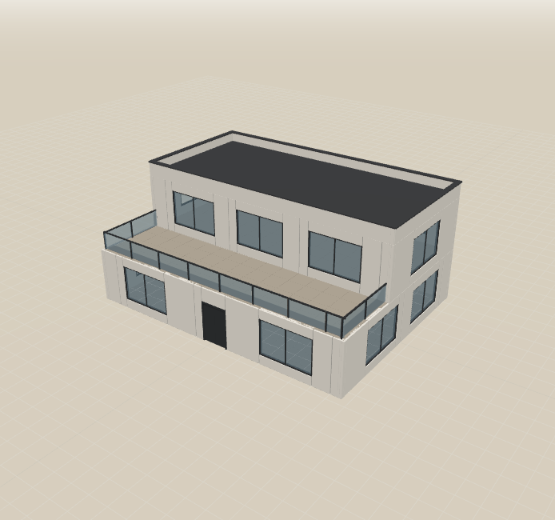
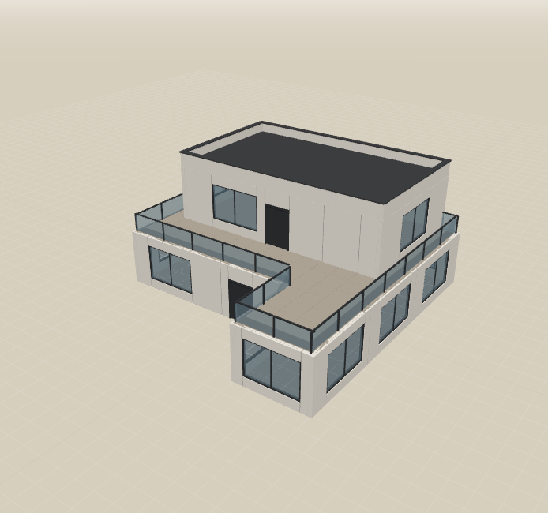
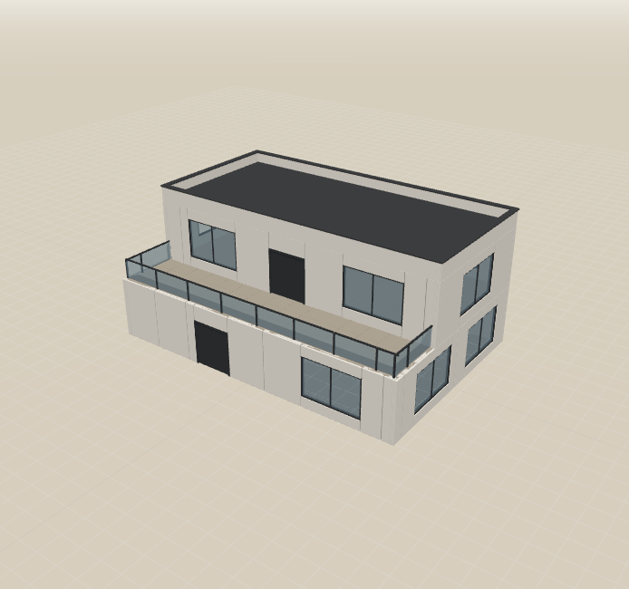
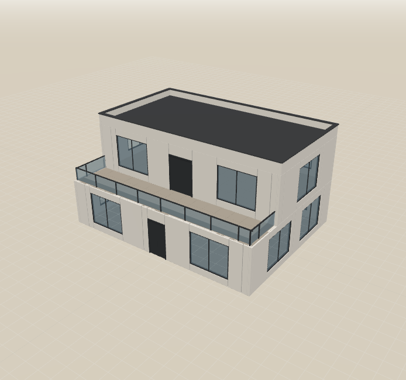
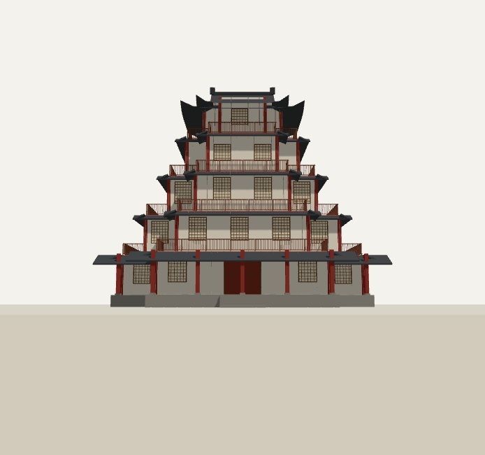
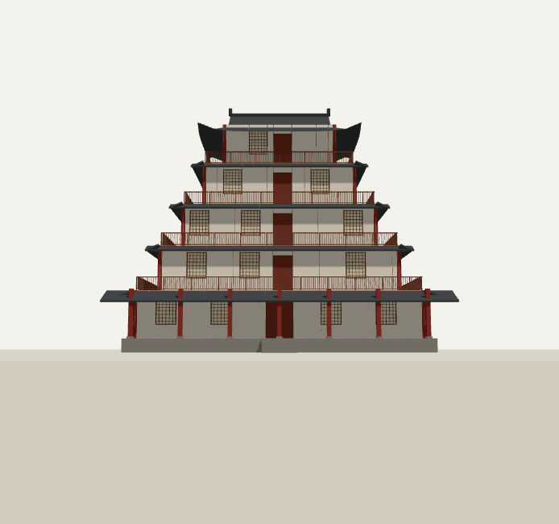
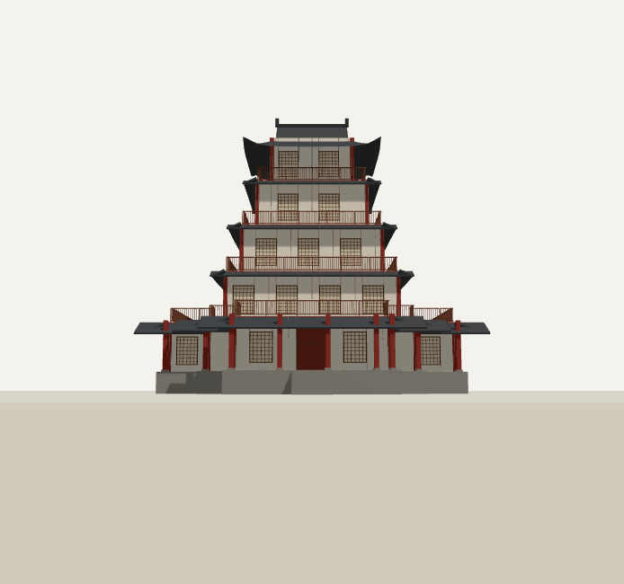
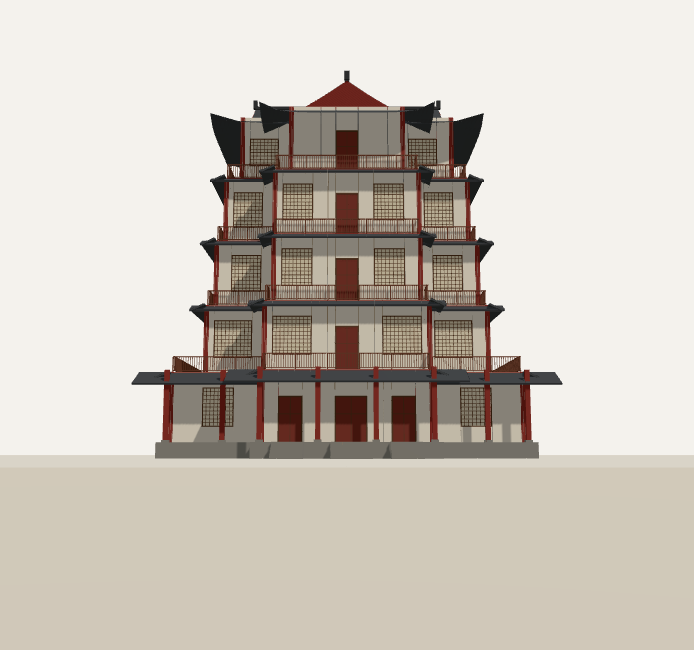

# UGC 建筑生成 Agent 评测结果

### 本轮得分

运行批次 2026-11-21-four-models。 [本轮冻结配置](configuration.json)

分数对应本轮冻结题目和配置。首轮通过指求解器零错误，任务成功还要求达到题目验收线。生成时长包含模型调用、修复和求解，截图另行执行。
综合分为文字组 50% 加多模态组 50%。

| 模型 | 成功／部分／失败 | 文字 100 | 多模态 100 | 综合 100 | 首轮通过 | 生成中位耗时 |
|---|---|---:|---:|---:|---:|---:|
| GPT‑6.2 Astra | 13／2／0 | 93.43 | 87.25 | **90.34** | 12/15 | 24.1 s |
| DeepSeek Flash | 11／4／0 | 90.38 | 78.00 | **84.19** | 13/15 | 11.2 s |
| 混元 HY4 | 10／5／0 | 90.34 | 72.20 | **81.27** | 12/15 | 3.9 s |
| 混元 HY4 Flash | 11／4／0 | 89.44 | 69.25 | **79.35** | 15/15 | 2.7 s |

| 模型 | 文字规则 30 | 贴合 25 | 美感 20 | 地标 25 | 图片规则 30 | 轮廓 25 | 体块与屋顶 25 | 立面 20 |
|---|---:|---:|---:|---:|---:|---:|---:|---:|
| GPT‑6.2 Astra | 30.00 | 22.83 | 17.20 | 23.40 | 30.00 | 23.75 | 22.50 | 11.00 |
| DeepSeek Flash | 30.00 | 22.78 | 15.20 | 22.40 | 30.00 | 21.25 | 18.75 | 8.00 |
| 混元 HY4 | 30.00 | 22.74 | 17.20 | 20.40 | 29.20 | 17.50 | 17.50 | 8.00 |
| 混元 HY4 Flash | 30.00 | 22.84 | 16.60 | 20.00 | 30.00 | 16.25 | 15.00 | 8.00 |

本轮贴合度通过向量接口使用 hunyuan-embedding-20250716 的 1024 维向量。 [本轮向量模型记录](embedding.json)

前三名总分相差 9.07 分，每题一次的结果适合比较这批产物。GPT‑6.2 Astra 的美感分最高，为 17.20/20。

### 同题建筑产物

#### T01 两层现代退台住宅

> 一座两层现代住宅，平屋顶，南面入户，二层向北收进，在南边留带栏杆的露台。

| 混元 HY4 | 混元 HY4 Flash | DeepSeek Flash | GPT‑6.2 Astra |
| --- | --- | --- | --- |
|  |  |  |  |

#### M03 黄鹤楼

[参考图](../../../Image-Test/normalized/Huanghelou.jpg)

| 混元 HY4 | 混元 HY4 Flash | DeepSeek Flash | GPT‑6.2 Astra |
| --- | --- | --- | --- |
|  |  |  |  |

### 逐题任务记录

#### 混元 HY4

| 题号 | 状态 | 轮次与耗时 | 具体表现 | 产物 |
|---|---|---|---|---|
| T01 | 成功 | 1 轮 · 4.6 s | 418 个预制件。要求命中 5/5。规则 30.00/30，贴合 23.00/25，美感 19.00/20。Sol 观察「南面上层三窗等距排列，下层双窗夹中央入口，两层共享中轴，平直屋沿与露台栏杆呼应。」 | [逐轮记录](T01/hy4/generation.json) · [设计](T01/hy4/design_spec.json) · [摆放](T01/hy4/placements.json) · [正面](T01/hy4/front.png) · [斜俯](T01-hy4.png) · [裁判](T01/hy4/judge.json) · [分项](T01/hy4/score.json) |
| T02 | 成功 | 1 轮 · 8.1 s | 528 个预制件。要求命中 5/5。规则 30.00/30，贴合 23.43/25，美感 17.00/20。Sol 观察「两道环廊随体块逐层内收，底层与二层均以格窗夹中门，顶层正面的整片墙使开口节奏在上部收束。」 | [逐轮记录](T02/hy4/generation.json) · [设计](T02/hy4/design_spec.json) · [摆放](T02/hy4/placements.json) · [正面](T02/hy4/front.png) · [斜俯](T02/hy4/oblique.png) · [裁判](T02/hy4/judge.json) · [分项](T02/hy4/score.json) |
| T03 | 成功 | 1 轮 · 2.0 s | 230 个预制件。要求命中 5/5。规则 30.00/30，贴合 22.26/25，美感 18.00/20。Sol 观察「主屋四窗的横向节奏延续到东翼，两道平行屋脊随体量由高到低，墙面与窗套做法一致。」 | [逐轮记录](T03/hy4/generation.json) · [设计](T03/hy4/design_spec.json) · [摆放](T03/hy4/placements.json) · [正面](T03/hy4/front.png) · [斜俯](T03/hy4/oblique.png) · [裁判](T03/hy4/judge.json) · [分项](T03/hy4/score.json) |
| T04 | 成功 | 1 轮 · 2.0 s | 125 个预制件。要求命中 5/5。规则 30.00/30，贴合 22.04/25，美感 15.00/20。Sol 观察「两张图呈现的屋面轮廓、墙板分缝和基座比例均与A一致。」 | [逐轮记录](T04/hy4/generation.json) · [设计](T04/hy4/design_spec.json) · [摆放](T04/hy4/placements.json) · [正面](T04/hy4/front.png) · [斜俯](T04/hy4/oblique.png) · [裁判](T04/hy4/judge.json) · [分项](T04/hy4/score.json) |
| T05 | 成功 | 1 轮 · 2.4 s | 234 个预制件。要求命中 5/5。规则 30.00/30，贴合 22.97/25，美感 17.00/20。Sol 观察「南立面三扇格窗等距排开，四翼屋面围出开阔的方形庭院。」 | [逐轮记录](T05/hy4/generation.json) · [设计](T05/hy4/design_spec.json) · [摆放](T05/hy4/placements.json) · [正面](T05/hy4/front.png) · [斜俯](T05/hy4/oblique.png) · [裁判](T05/hy4/judge.json) · [分项](T05/hy4/score.json) |
| L01 | 成功 | 1 轮 · 3.3 s | 1612 个预制件。要求命中 5/5。地标 24.00/25。Sol 观察「殿身横阔，两层体量居中叠置，抬高的台基设中央踏步。两层格窗成列对称，上部四坡顶清晰，下檐偏浅，形似披檐。」 | [逐轮记录](L01/hy4/generation.json) · [设计](L01/hy4/design_spec.json) · [摆放](L01/hy4/placements.json) · [正面](L01/hy4/front.png) · [斜俯](L01/hy4/oblique.png) · [裁判](L01/hy4/judge.json) · [分项](L01/hy4/score.json) |
| L02 | 成功 | 1 轮 · 6.3 s | 1230 个预制件。要求命中 5/5。地标 24.00/25。Sol 观察「五层白墙体量向上收窄，连续深色挑檐勾勒出城堡塔楼轮廓，最上层屋顶坡度较缓。」 | [逐轮记录](L02/hy4/generation.json) · [设计](L02/hy4/design_spec.json) · [摆放](L02/hy4/placements.json) · [正面](L02/hy4/front.png) · [斜俯](L02/hy4/oblique.png) · [裁判](L02/hy4/judge.json) · [分项](L02/hy4/score.json) |
| L03 | 成功 | 1 轮 · 3.9 s | 1049 个预制件。要求命中 5/5。地标 21.00/25。Sol 观察「三层主体比例较高，浅色立面的竖窗和三处入口对称排列。中央门较宽，正面体量和连续坡顶的中段缺少独立构件。」 | [逐轮记录](L03/hy4/generation.json) · [设计](L03/hy4/design_spec.json) · [摆放](L03/hy4/placements.json) · [正面](L03/hy4/front.png) · [斜俯](L03/hy4/oblique.png) · [裁判](L03/hy4/judge.json) · [分项](L03/hy4/score.json) |
| L04 | 部分完成 | 3 轮 · 10.0 s | 1922 个预制件。要求命中 4/5，缺少近方形占地。首轮 E_BLOCKS。地标 17.00/25。Sol 观察「主体宽扁，宽露台上的中央亭体偏小。屋顶居中但起高有限，正立面对称，入口居中，台基较低。」 | [逐轮记录](L04/hy4/generation.json) · [设计](L04/hy4/design_spec.json) · [摆放](L04/hy4/placements.json) · [正面](L04/hy4/front.png) · [斜俯](L04/hy4/oblique.png) · [裁判](L04/hy4/judge.json) · [分项](L04/hy4/score.json) |
| L05 | 部分完成 | 1 轮 · 3.0 s | 234 个预制件。要求命中 3/5，缺少矩形占地、宽门楼。地标 16.00/25。Sol 观察「正面横向展开，平屋顶下的中央双扇门与两侧对称窗形成明确中轴。斜俯视可见进深较大，中央体块前凸，两侧退后，厚墩夹门的关系较弱。」 | [逐轮记录](L05/hy4/generation.json) · [设计](L05/hy4/design_spec.json) · [摆放](L05/hy4/placements.json) · [正面](L05/hy4/front.png) · [斜俯](L05/hy4/oblique.png) · [裁判](L05/hy4/judge.json) · [分项](L05/hy4/score.json) |
| M01 | 部分完成 | 2 轮 · 8.4 s | 662 个预制件。首轮 E_DOOR_NOT_EXTERIOR、E_NO_ENTRANCE。规则 28.00/30，轮廓 18.75/25，体块及屋顶 6.25/25，立面 10.00/20，合计 63.00/100。核心项「居中立柱门廊」为 0/2，短柱沿前平台分散排列，中央入口上方缺少由立柱承托的门廊顶。 | [逐轮记录](M01/hy4/generation.json) · [设计](M01/hy4/design_spec.json) · [摆放](M01/hy4/placements.json) · [主视图](M01/hy4/front.png) · [斜俯](M01/hy4/oblique.png) · [裁判](M01/hy4/judge.json) · [分项](M01/hy4/score.json) |
| M02 | 成功 | 1 轮 · 4.8 s | 1297 个预制件。规则 30.00/30，轮廓 18.75/25，体块及屋顶 25.00/25，立面 10.00/20，合计 83.75/100。核心项「多层成排的重复开口」为 2/2，主体各层排列着三至四个重复窗洞，斜俯视可见同样的成排开口延续到侧面。 | [逐轮记录](M02/hy4/generation.json) · [设计](M02/hy4/design_spec.json) · [摆放](M02/hy4/placements.json) · [主视图](M02/hy4/front.png) · [斜俯](M02/hy4/oblique.png) · [裁判](M02/hy4/judge.json) · [分项](M02/hy4/score.json) |
| M03 | 成功 | 2 轮 · 10.0 s | 1833 个预制件。首轮 E_BLOCKS。规则 28.00/30，轮廓 18.75/25，体块及屋顶 25.00/25，立面 15.00/20，合计 86.75/100。核心项「多道清楚可辨的外挑檐」为 2/2，主视图中多道檐口上下分明，斜俯视可见檐带沿楼身转角连续外挑。 | [逐轮记录](M03/hy4/generation.json) · [设计](M03/hy4/design_spec.json) · [摆放](M03/hy4/placements.json) · [主视图](M03-hy4.png) · [斜俯](M03/hy4/oblique.png) · [裁判](M03/hy4/judge.json) · [分项](M03/hy4/score.json) |
| M04 | 部分完成 | 1 轮 · 3.9 s | 711 个预制件。规则 30.00/30，轮廓 25.00/25，体块及屋顶 18.75/25，立面 0.00/20，合计 73.75/100。核心项「居中高起的顶体量」为 1/2，斜俯视可见中央有独立抬高的四坡主屋顶，但坡度较缓，顶部隆起的比例低于参考图。 | [逐轮记录](M04/hy4/generation.json) · [设计](M04/hy4/design_spec.json) · [摆放](M04/hy4/placements.json) · [主视图](M04/hy4/front.png) · [斜俯](M04/hy4/oblique.png) · [裁判](M04/hy4/judge.json) · [分项](M04/hy4/score.json) |
| M05 | 部分完成 | 1 轮 · 3.9 s | 220 个预制件。规则 30.00/30，轮廓 6.25/25，体块及屋顶 12.50/25，立面 5.00/20，合计 53.75/100。核心项「开口居中，宽度与两墩的比例接近原图」为 1/2，双扇门居中，但门宽约占主体宽度的15%，两侧墙段相对于开口比参考图长。 | [逐轮记录](M05/hy4/generation.json) · [设计](M05/hy4/design_spec.json) · [摆放](M05/hy4/placements.json) · [主视图](M05/hy4/front.png) · [斜俯](M05/hy4/oblique.png) · [裁判](M05/hy4/judge.json) · [分项](M05/hy4/score.json) |
#### 混元 HY4 Flash

| 题号 | 状态 | 轮次与耗时 | 具体表现 | 产物 |
|---|---|---|---|---|
| T01 | 成功 | 1 轮 · 4.8 s | 407 个预制件。要求命中 5/5。规则 30.00/30，贴合 23.11/25，美感 17.00/20。Sol 观察「东侧凸出体量由转折露台串联，上层窗集中在南面左侧，右侧留出较宽实墙。」 | [逐轮记录](T01/hy4-flash/generation.json) · [设计](T01/hy4-flash/design_spec.json) · [摆放](T01/hy4-flash/placements.json) · [正面](T01/hy4-flash/front.png) · [斜俯](T01-hy4-flash.png) · [裁判](T01/hy4-flash/judge.json) · [分项](T01/hy4-flash/score.json) |
| T02 | 成功 | 1 轮 · 2.3 s | 634 个预制件。要求命中 5/5。规则 30.00/30，贴合 23.39/25，美感 20.00/20。Sol 观察「台阶与三层中门形成连续中轴，下两层的成对格窗呼应中轴，逐层缩窄的檐口收于两端上翘的顶屋面。」 | [逐轮记录](T02/hy4-flash/generation.json) · [设计](T02/hy4-flash/design_spec.json) · [摆放](T02/hy4-flash/placements.json) · [正面](T02/hy4-flash/front.png) · [斜俯](T02/hy4-flash/oblique.png) · [裁判](T02/hy4-flash/judge.json) · [分项](T02/hy4-flash/score.json) |
| T03 | 成功 | 1 轮 · 1.7 s | 218 个预制件。要求命中 5/5。规则 30.00/30，贴合 22.63/25，美感 15.00/20。Sol 观察「主屋三窗近似等距，窄翼山墙以单窗居中，但翼部屋面相对墙体外挑较深。」 | [逐轮记录](T03/hy4-flash/generation.json) · [设计](T03/hy4-flash/design_spec.json) · [摆放](T03/hy4-flash/placements.json) · [正面](T03/hy4-flash/front.png) · [斜俯](T03/hy4-flash/oblique.png) · [裁判](T03/hy4-flash/judge.json) · [分项](T03/hy4-flash/score.json) |
| T04 | 成功 | 1 轮 · 1.6 s | 139 个预制件。要求命中 5/5。服务错误 proxy_error 后统一复试一次。规则 30.00/30，贴合 22.10/25，美感 13.00/20。Sol 观察「正视图中深灰屋面相对墙身更高，出檐下六块等宽墙板仍保持整齐。」 | [逐轮记录](T04/hy4-flash/generation.json) · [设计](T04/hy4-flash/design_spec.json) · [摆放](T04/hy4-flash/placements.json) · [正面](T04/hy4-flash/front.png) · [斜俯](T04/hy4-flash/oblique.png) · [裁判](T04/hy4-flash/judge.json) · [分项](T04/hy4-flash/score.json) |
| T05 | 成功 | 1 轮 · 2.2 s | 257 个预制件。要求命中 5/5。规则 30.00/30，贴合 22.97/25，美感 18.00/20。Sol 观察「南立面四扇横向格窗大小一致、间距均匀，两端留白接近。」 | [逐轮记录](T05/hy4-flash/generation.json) · [设计](T05/hy4-flash/design_spec.json) · [摆放](T05/hy4-flash/placements.json) · [正面](T05/hy4-flash/front.png) · [斜俯](T05/hy4-flash/oblique.png) · [裁判](T05/hy4-flash/judge.json) · [分项](T05/hy4-flash/score.json) |
| L01 | 成功 | 1 轮 · 2.0 s | 1881 个预制件。要求命中 5/5。地标 22.00/25。Sol 观察「横阔殿身、抬高台基和成列格窗清楚可辨。上层殿身与四坡顶相对入口及台基偏左，两层中轴错开，下檐也偏浅。」 | [逐轮记录](L01/hy4-flash/generation.json) · [设计](L01/hy4-flash/design_spec.json) · [摆放](L01/hy4-flash/placements.json) · [正面](L01/hy4-flash/front.png) · [斜俯](L01/hy4-flash/oblique.png) · [裁判](L01/hy4-flash/judge.json) · [分项](L01/hy4-flash/score.json) |
| L02 | 成功 | 1 轮 · 3.9 s | 1598 个预制件。要求命中 5/5。地标 22.00/25。Sol 观察「五层退台和白墙格窗清晰，深色外挑檐可辨。塔身较宽，顶屋面低缓，高耸感较弱。」 | [逐轮记录](L02/hy4-flash/generation.json) · [设计](L02/hy4-flash/design_spec.json) · [摆放](L02/hy4-flash/placements.json) · [正面](L02/hy4-flash/front.png) · [斜俯](L02/hy4-flash/oblique.png) · [裁判](L02/hy4-flash/judge.json) · [分项](L02/hy4-flash/score.json) |
| L03 | 成功 | 1 轮 · 2.0 s | 789 个预制件。要求命中 5/5。地标 25.00/25。Sol 观察「低宽主体两翼对称，浅色立面排列两层竖窗。中央入口体量前凸，独立小坡顶近似山花，与居中的双门共同突出中轴。」 | [逐轮记录](L03/hy4-flash/generation.json) · [设计](L03/hy4-flash/design_spec.json) · [摆放](L03/hy4-flash/placements.json) · [正面](L03/hy4-flash/front.png) · [斜俯](L03/hy4-flash/oblique.png) · [裁判](L03/hy4-flash/judge.json) · [分项](L03/hy4-flash/score.json) |
| L04 | 成功 | 1 轮 · 2.0 s | 713 个预制件。要求命中 5/5。地标 22.00/25。Sol 观察「近方形主体与内退上层的关系清楚，中央屋顶明显高起。整体偏低展，入口与墙面齐平，台基较低。」 | [逐轮记录](L04/hy4-flash/generation.json) · [设计](L04/hy4-flash/design_spec.json) · [摆放](L04/hy4-flash/placements.json) · [正面](L04/hy4-flash/front.png) · [斜俯](L04/hy4-flash/oblique.png) · [裁判](L04/hy4-flash/judge.json) · [分项](L04/hy4-flash/score.json) |
| L05 | 部分完成 | 1 轮 · 2.7 s | 1308 个预制件。要求命中 2/5，缺少矩形占地、宽门楼、居中宽门洞近似。地标 9.00/25。Sol 观察「外轮廓为浅色矩形，顶部水平，斜俯视可见进深较大的围合体和中央天井。正面由重复窗列构成，入口位于侧面，正面缺少居中大开口与两侧厚墩的组合。」 | [逐轮记录](L05/hy4-flash/generation.json) · [设计](L05/hy4-flash/design_spec.json) · [摆放](L05/hy4-flash/placements.json) · [正面](L05/hy4-flash/front.png) · [斜俯](L05/hy4-flash/oblique.png) · [裁判](L05/hy4-flash/judge.json) · [分项](L05/hy4-flash/score.json) |
| M01 | 部分完成 | 1 轮 · 3.0 s | 671 个预制件。规则 30.00/30，轮廓 12.50/25，体块及屋顶 6.25/25，立面 5.00/20，合计 53.75/100。核心项「居中立柱门廊」为 0/2，短柱沿通长平台分布，中央门前缺少成组柱列和门廊顶。 | [逐轮记录](M01/hy4-flash/generation.json) · [设计](M01/hy4-flash/design_spec.json) · [摆放](M01/hy4-flash/placements.json) · [主视图](M01/hy4-flash/front.png) · [斜俯](M01/hy4-flash/oblique.png) · [裁判](M01/hy4-flash/judge.json) · [分项](M01/hy4-flash/score.json) |
| M02 | 成功 | 1 轮 · 3.8 s | 1098 个预制件。规则 30.00/30，轮廓 25.00/25，体块及屋顶 25.00/25，立面 10.00/20，合计 90.00/100。核心项「多层成排的重复开口」为 2/2，主立面中段多层均有成排的竖向窗洞，斜俯视可见侧立面也连续重复这一排列。 | [逐轮记录](M02/hy4-flash/generation.json) · [设计](M02/hy4-flash/design_spec.json) · [摆放](M02/hy4-flash/placements.json) · [主视图](M02/hy4-flash/front.png) · [斜俯](M02/hy4-flash/oblique.png) · [裁判](M02/hy4-flash/judge.json) · [分项](M02/hy4-flash/score.json) |
| M03 | 成功 | 1 轮 · 4.2 s | 1648 个预制件。规则 30.00/30，轮廓 18.75/25，体块及屋顶 25.00/25，立面 15.00/20，合计 88.75/100。核心项「多道清楚可辨的外挑檐」为 2/2，多道檐口在主视图中形成分明的水平层次，斜俯视可见各道檐口伸出墙面。 | [逐轮记录](M03/hy4-flash/generation.json) · [设计](M03/hy4-flash/design_spec.json) · [摆放](M03/hy4-flash/placements.json) · [主视图](M03-hy4-flash.png) · [斜俯](M03/hy4-flash/oblique.png) · [裁判](M03/hy4-flash/judge.json) · [分项](M03/hy4-flash/score.json) |
| M04 | 部分完成 | 1 轮 · 3.1 s | 833 个预制件。规则 30.00/30，轮廓 18.75/25，体块及屋顶 6.25/25，立面 5.00/20，合计 60.00/100。核心项「居中高起的顶体量」为 1/2，中央四坡顶宽而居中，但顶坡较缓，高起部分相对于立面偏低。 | [逐轮记录](M04/hy4-flash/generation.json) · [设计](M04/hy4-flash/design_spec.json) · [摆放](M04/hy4-flash/placements.json) · [主视图](M04/hy4-flash/front.png) · [斜俯](M04/hy4-flash/oblique.png) · [裁判](M04/hy4-flash/judge.json) · [分项](M04/hy4-flash/score.json) |
| M05 | 部分完成 | 1 轮 · 3.3 s | 379 个预制件。规则 30.00/30，轮廓 6.25/25，体块及屋顶 12.50/25，立面 5.00/20，合计 53.75/100。核心项「开口居中，宽度与两墩的比例接近原图」为 1/2，入口位于正中央，但门宽仅约占主体宽度的10%，相对两侧墙面明显小于参考图的开口。 | [逐轮记录](M05/hy4-flash/generation.json) · [设计](M05/hy4-flash/design_spec.json) · [摆放](M05/hy4-flash/placements.json) · [主视图](M05/hy4-flash/front.png) · [斜俯](M05/hy4-flash/oblique.png) · [裁判](M05/hy4-flash/judge.json) · [分项](M05/hy4-flash/score.json) |
#### DeepSeek Flash

| 题号 | 状态 | 轮次与耗时 | 具体表现 | 产物 |
|---|---|---|---|---|
| T01 | 成功 | 1 轮 · 4.3 s | 385 个预制件。要求命中 5/5。规则 30.00/30，贴合 23.00/25，美感 17.00/20。Sol 观察「上层双窗对称夹门，首层入口左移且左端留有大块实墙，立面节奏主要由连续栏杆维系。」 | [逐轮记录](T01/deepseek-flash/generation.json) · [设计](T01/deepseek-flash/design_spec.json) · [摆放](T01/deepseek-flash/placements.json) · [正面](T01/deepseek-flash/front.png) · [斜俯](T01-deepseek-flash.png) · [裁判](T01/deepseek-flash/judge.json) · [分项](T01/deepseek-flash/score.json) |
| T02 | 成功 | 1 轮 · 12.0 s | 844 个预制件。要求命中 5/5。规则 30.00/30，贴合 23.20/25，美感 16.00/20。Sol 观察「二层四扇格窗沿正面近等距排列，长屋脊呼应横向展开的体块，顶层檐宽接近二层檐宽，使上部收分较缓。」 | [逐轮记录](T02/deepseek-flash/generation.json) · [设计](T02/deepseek-flash/design_spec.json) · [摆放](T02/deepseek-flash/placements.json) · [正面](T02/deepseek-flash/front.png) · [斜俯](T02/deepseek-flash/oblique.png) · [裁判](T02/deepseek-flash/judge.json) · [分项](T02/deepseek-flash/score.json) |
| T03 | 成功 | 1 轮 · 3.7 s | 229 个预制件。要求命中 5/5。规则 30.00/30，贴合 22.68/25，美感 15.00/20。Sol 观察「南侧五窗间距近似，东翼体量较小，两片屋檐在交接处形成显眼的三角叠影。」 | [逐轮记录](T03/deepseek-flash/generation.json) · [设计](T03/deepseek-flash/design_spec.json) · [摆放](T03/deepseek-flash/placements.json) · [正面](T03/deepseek-flash/front.png) · [斜俯](T03/deepseek-flash/oblique.png) · [裁判](T03/deepseek-flash/judge.json) · [分项](T03/deepseek-flash/score.json) |
| T04 | 成功 | 1 轮 · 2.1 s | 125 个预制件。要求命中 5/5。规则 30.00/30，贴合 22.04/25，美感 15.00/20。Sol 观察「深灰屋面与木色基座形成清楚的上下边界，南面六块墙板等距排列，门窗轮廓难以辨认。」 | [逐轮记录](T04/deepseek-flash/generation.json) · [设计](T04/deepseek-flash/design_spec.json) · [摆放](T04/deepseek-flash/placements.json) · [正面](T04/deepseek-flash/front.png) · [斜俯](T04/deepseek-flash/oblique.png) · [裁判](T04/deepseek-flash/judge.json) · [分项](T04/deepseek-flash/score.json) |
| T05 | 成功 | 1 轮 · 4.8 s | 268 个预制件。要求命中 5/5。规则 30.00/30，贴合 22.98/25，美感 13.00/20。Sol 观察「南立面四窗排列规整，西侧外露柱列使立面节奏偏向一端，部分柱顶高出檐线。」 | [逐轮记录](T05/deepseek-flash/generation.json) · [设计](T05/deepseek-flash/design_spec.json) · [摆放](T05/deepseek-flash/placements.json) · [正面](T05/deepseek-flash/front.png) · [斜俯](T05/deepseek-flash/oblique.png) · [裁判](T05/deepseek-flash/judge.json) · [分项](T05/deepseek-flash/score.json) |
| L01 | 成功 | 2 轮 · 11.2 s | 2162 个预制件。要求命中 5/5。首轮 E_BLOCKS。地标 24.00/25。Sol 观察「宽台基与两层殿身对齐，中央门和主踏步突出中轴，两侧门窗成对布置。上部四坡顶清晰，下层为浅窄披檐。」 | [逐轮记录](L01/deepseek-flash/generation.json) · [设计](L01/deepseek-flash/design_spec.json) · [摆放](L01/deepseek-flash/placements.json) · [正面](L01/deepseek-flash/front.png) · [斜俯](L01/deepseek-flash/oblique.png) · [裁判](L01/deepseek-flash/judge.json) · [分项](L01/deepseek-flash/score.json) |
| L02 | 成功 | 1 轮 · 9.9 s | 1093 个预制件。要求命中 5/5。地标 25.00/25。Sol 观察「五层逐级收窄，白墙配深色格窗，层层外挑檐与陡坡顶形成鲜明的天守阁轮廓。」 | [逐轮记录](L02/deepseek-flash/generation.json) · [设计](L02/deepseek-flash/design_spec.json) · [摆放](L02/deepseek-flash/placements.json) · [正面](L02/deepseek-flash/front.png) · [斜俯](L02/deepseek-flash/oblique.png) · [裁判](L02/deepseek-flash/judge.json) · [分项](L02/deepseek-flash/score.json) |
| L03 | 成功 | 3 轮 · 20.5 s | 2604 个预制件。要求命中 5/5。首轮 E_BLOCKS。地标 21.00/25。Sol 观察「四层浅色立面横向展开，竖窗成排对称排列。主体基本齐平，中央台阶和双门标出中轴，平屋顶没有中央山花式构件。」 | [逐轮记录](L03/deepseek-flash/generation.json) · [设计](L03/deepseek-flash/design_spec.json) · [摆放](L03/deepseek-flash/placements.json) · [正面](L03/deepseek-flash/front.png) · [斜俯](L03/deepseek-flash/oblique.png) · [裁判](L03/deepseek-flash/judge.json) · [分项](L03/deepseek-flash/score.json) |
| L04 | 成功 | 1 轮 · 12.4 s | 833 个预制件。要求命中 5/5。地标 21.00/25。Sol 观察「中央主屋顶明显高于两侧小屋顶。角部体量前凸，中央入口位于内退墙面，浅色立面横向对称，台基较低。」 | [逐轮记录](L04/deepseek-flash/generation.json) · [设计](L04/deepseek-flash/design_spec.json) · [摆放](L04/deepseek-flash/placements.json) · [正面](L04/deepseek-flash/front.png) · [斜俯](L04/deepseek-flash/oblique.png) · [裁判](L04/deepseek-flash/judge.json) · [分项](L04/deepseek-flash/score.json) |
| L05 | 成功 | 1 轮 · 12.0 s | 944 个预制件。要求命中 5/5。地标 21.00/25。Sol 观察「浅色矩形体进深较浅，屋顶水平。底层双扇门居中，但多层窗列主导立面，门两侧没有独立可辨的厚墩体量。」 | [逐轮记录](L05/deepseek-flash/generation.json) · [设计](L05/deepseek-flash/design_spec.json) · [摆放](L05/deepseek-flash/placements.json) · [正面](L05/deepseek-flash/front.png) · [斜俯](L05/deepseek-flash/oblique.png) · [裁判](L05/deepseek-flash/judge.json) · [分项](L05/deepseek-flash/score.json) |
| M01 | 部分完成 | 1 轮 · 22.9 s | 1207 个预制件。规则 30.00/30，轮廓 25.00/25，体块及屋顶 12.50/25，立面 10.00/20，合计 77.50/100。核心项「居中立柱门廊」为 0/2，中央入口嵌在凸体墙面内，门前缺少独立立柱。 | [逐轮记录](M01/deepseek-flash/generation.json) · [设计](M01/deepseek-flash/design_spec.json) · [摆放](M01/deepseek-flash/placements.json) · [主视图](M01/deepseek-flash/front.png) · [斜俯](M01/deepseek-flash/oblique.png) · [裁判](M01/deepseek-flash/judge.json) · [分项](M01/deepseek-flash/score.json) |
| M02 | 部分完成 | 1 轮 · 7.9 s | 754 个预制件。规则 30.00/30，轮廓 25.00/25，体块及屋顶 25.00/25，立面 5.00/20，合计 85.00/100。核心项「多层成排的重复开口」为 1/2，主立面多个楼层重复中央门与两侧窗的组合，斜俯视也可见侧面成排窗洞，但主立面的同类开口较稀疏。 | [逐轮记录](M02/deepseek-flash/generation.json) · [设计](M02/deepseek-flash/design_spec.json) · [摆放](M02/deepseek-flash/placements.json) · [主视图](M02/deepseek-flash/front.png) · [斜俯](M02/deepseek-flash/oblique.png) · [裁判](M02/deepseek-flash/judge.json) · [分项](M02/deepseek-flash/score.json) |
| M03 | 成功 | 1 轮 · 25.5 s | 1343 个预制件。规则 30.00/30，轮廓 25.00/25，体块及屋顶 25.00/25，立面 15.00/20，合计 95.00/100。核心项「多道清楚可辨的外挑檐」为 2/2，主视图可分辨多道独立的外挑檐，斜俯视可见它们沿楼身各面伸出。 | [逐轮记录](M03/deepseek-flash/generation.json) · [设计](M03/deepseek-flash/design_spec.json) · [摆放](M03/deepseek-flash/placements.json) · [主视图](M03-deepseek-flash.png) · [斜俯](M03/deepseek-flash/oblique.png) · [裁判](M03/deepseek-flash/judge.json) · [分项](M03/deepseek-flash/score.json) |
| M04 | 部分完成 | 1 轮 · 11.7 s | 634 个预制件。规则 30.00/30，轮廓 18.75/25，体块及屋顶 12.50/25，立面 5.00/20，合计 66.25/100。核心项「居中高起的顶体量」为 2/2，高起的四坡屋顶位于正中，尖顶与宽檐形成清楚的中央主顶体量。 | [逐轮记录](M04/deepseek-flash/generation.json) · [设计](M04/deepseek-flash/design_spec.json) · [摆放](M04/deepseek-flash/placements.json) · [主视图](M04/deepseek-flash/front.png) · [斜俯](M04/deepseek-flash/oblique.png) · [裁判](M04/deepseek-flash/judge.json) · [分项](M04/deepseek-flash/score.json) |
| M05 | 部分完成 | 1 轮 · 8.9 s | 463 个预制件。规则 30.00/30，轮廓 12.50/25，体块及屋顶 18.75/25，立面 5.00/20，合计 66.25/100。核心项「开口居中，宽度与两墩的比例接近原图」为 1/2，双扇门位于正中央，约占主体宽度的18%，参考图的开口约占四分之一，候选开口偏窄。 | [逐轮记录](M05/deepseek-flash/generation.json) · [设计](M05/deepseek-flash/design_spec.json) · [摆放](M05/deepseek-flash/placements.json) · [主视图](M05/deepseek-flash/front.png) · [斜俯](M05/deepseek-flash/oblique.png) · [裁判](M05/deepseek-flash/judge.json) · [分项](M05/deepseek-flash/score.json) |
#### GPT‑6.2 Astra

| 题号 | 状态 | 轮次与耗时 | 具体表现 | 产物 |
|---|---|---|---|---|
| T01 | 成功 | 1 轮 · 13.0 s | 420 个预制件。要求命中 5/5。规则 30.00/30，贴合 23.16/25，美感 20.00/20。Sol 观察「二层退台让上下体块层次清楚，两层中央门与两侧窗上下对位，屋沿与栏杆形成平行横线。」 | [逐轮记录](T01/gpt-6.2-astra/generation.json) · [设计](T01/gpt-6.2-astra/design_spec.json) · [摆放](T01/gpt-6.2-astra/placements.json) · [正面](T01/gpt-6.2-astra/front.png) · [斜俯](T01-gpt-6.2-astra.png) · [裁判](T01/gpt-6.2-astra/judge.json) · [分项](T01/gpt-6.2-astra/score.json) |
| T02 | 成功 | 1 轮 · 16.2 s | 773 个预制件。要求命中 5/5。规则 30.00/30，贴合 23.31/25，美感 16.00/20。Sol 观察「三层檐口随台基向上逐级收窄，首层格窗成对分布，二层中门西侧两窗、东侧一窗，左右节奏出现变化。」 | [逐轮记录](T02/gpt-6.2-astra/generation.json) · [设计](T02/gpt-6.2-astra/design_spec.json) · [摆放](T02/gpt-6.2-astra/placements.json) · [正面](T02/gpt-6.2-astra/front.png) · [斜俯](T02/gpt-6.2-astra/oblique.png) · [裁判](T02/gpt-6.2-astra/judge.json) · [分项](T02/gpt-6.2-astra/score.json) |
| T03 | 成功 | 1 轮 · 13.6 s | 208 个预制件。要求命中 5/5。规则 30.00/30，贴合 22.72/25，美感 18.00/20。Sol 观察「前伸的东翼与横向主屋形成清晰的主次关系，翼部双窗分列山墙两侧，红褐色屋面与浅色窗套贯穿两翼。」 | [逐轮记录](T03/gpt-6.2-astra/generation.json) · [设计](T03/gpt-6.2-astra/design_spec.json) · [摆放](T03/gpt-6.2-astra/placements.json) · [正面](T03/gpt-6.2-astra/front.png) · [斜俯](T03/gpt-6.2-astra/oblique.png) · [裁判](T03/gpt-6.2-astra/judge.json) · [分项](T03/gpt-6.2-astra/score.json) |
| T04 | 成功 | 1 轮 · 10.9 s | 97 个预制件。要求命中 5/5。规则 30.00/30，贴合 22.05/25，美感 15.00/20。Sol 观察「正视图中墙身相对屋面更高，南面五块较宽的墙板等距排列，两端由木色立柱收边。」 | [逐轮记录](T04/gpt-6.2-astra/generation.json) · [设计](T04/gpt-6.2-astra/design_spec.json) · [摆放](T04/gpt-6.2-astra/placements.json) · [正面](T04/gpt-6.2-astra/front.png) · [斜俯](T04/gpt-6.2-astra/oblique.png) · [裁判](T04/gpt-6.2-astra/judge.json) · [分项](T04/gpt-6.2-astra/score.json) |
| T05 | 成功 | 1 轮 · 16.7 s | 280 个预制件。要求命中 5/5。规则 30.00/30，贴合 22.94/25，美感 17.00/20。Sol 观察「南立面四扇格窗大小一致，斜俯视可见宽屋面围绕较紧凑的庭院展开。」 | [逐轮记录](T05/gpt-6.2-astra/generation.json) · [设计](T05/gpt-6.2-astra/design_spec.json) · [摆放](T05/gpt-6.2-astra/placements.json) · [正面](T05/gpt-6.2-astra/front.png) · [斜俯](T05/gpt-6.2-astra/oblique.png) · [裁判](T05/gpt-6.2-astra/judge.json) · [分项](T05/gpt-6.2-astra/score.json) |
| L01 | 成功 | 2 轮 · 42.2 s | 1951 个预制件。要求命中 5/5。首轮 E_BLOCKS。地标 24.00/25。Sol 观察「宽台基承托居中的两层殿身，中央五门与成组踏步形成鲜明中轴，两翼格窗对称。上部四坡顶宽展，下檐较薄，重檐层次较弱。」 | [逐轮记录](L01/gpt-6.2-astra/generation.json) · [设计](L01/gpt-6.2-astra/design_spec.json) · [摆放](L01/gpt-6.2-astra/placements.json) · [正面](L01/gpt-6.2-astra/front.png) · [斜俯](L01/gpt-6.2-astra/oblique.png) · [裁判](L01/gpt-6.2-astra/judge.json) · [分项](L01/gpt-6.2-astra/score.json) |
| L02 | 成功 | 1 轮 · 18.8 s | 2291 个预制件。要求命中 5/5。地标 25.00/25。Sol 观察「五层塔身高挑，退台清晰，深色坡顶和上翘檐角突出，白墙上排列窄格窗。」 | [逐轮记录](L02/gpt-6.2-astra/generation.json) · [设计](L02/gpt-6.2-astra/design_spec.json) · [摆放](L02/gpt-6.2-astra/placements.json) · [正面](L02/gpt-6.2-astra/front.png) · [斜俯](L02/gpt-6.2-astra/oblique.png) · [裁判](L02/gpt-6.2-astra/judge.json) · [分项](L02/gpt-6.2-astra/score.json) |
| L03 | 成功 | 2 轮 · 44.0 s | 2882 个预制件。要求命中 5/5。首轮 E_BLOCKS。地标 23.00/25。Sol 观察「三层浅色立面横向展开，中央与两端前凸，两翼退进，竖窗对称重复。中央阳台和下方三联入口清楚标出中轴，平屋顶没有山花式构件。」 | [逐轮记录](L03/gpt-6.2-astra/generation.json) · [设计](L03/gpt-6.2-astra/design_spec.json) · [摆放](L03/gpt-6.2-astra/placements.json) · [正面](L03/gpt-6.2-astra/front.png) · [斜俯](L03/gpt-6.2-astra/oblique.png) · [裁判](L03/gpt-6.2-astra/judge.json) · [分项](L03/gpt-6.2-astra/score.json) |
| L04 | 成功 | 2 轮 · 74.5 s | 8036 个预制件。要求命中 5/5。首轮 E_BLOCKS。地标 23.00/25。Sol 观察「近方形主体上方有明显高起的中央屋顶，入口所在墙段沿中轴前凸。上部体量明显收进，开窗下部占比偏大，底部台基较低。」 | [逐轮记录](L04/gpt-6.2-astra/generation.json) · [设计](L04/gpt-6.2-astra/design_spec.json) · [摆放](L04/gpt-6.2-astra/placements.json) · [正面](L04/gpt-6.2-astra/front.png) · [斜俯](L04/gpt-6.2-astra/oblique.png) · [裁判](L04/gpt-6.2-astra/judge.json) · [分项](L04/gpt-6.2-astra/score.json) |
| L05 | 部分完成 | 1 轮 · 24.1 s | 383 个预制件。要求命中 4/5，缺少矩形占地。地标 22.00/25。Sol 观察「整体呈进深较浅的浅色矩形体，屋顶水平。正面两侧厚重体块对称前凸，夹着居中内退的双扇门，门楼中轴清晰。」 | [逐轮记录](L05/gpt-6.2-astra/generation.json) · [设计](L05/gpt-6.2-astra/design_spec.json) · [摆放](L05/gpt-6.2-astra/placements.json) · [正面](L05/gpt-6.2-astra/front.png) · [斜俯](L05/gpt-6.2-astra/oblique.png) · [裁判](L05/gpt-6.2-astra/judge.json) · [分项](L05/gpt-6.2-astra/score.json) |
| M01 | 部分完成 | 1 轮 · 27.2 s | 1891 个预制件。规则 30.00/30，轮廓 25.00/25，体块及屋顶 12.50/25，立面 10.00/20，合计 77.50/100。核心项「居中立柱门廊」为 0/2，短柱沿首层前方分散排列，中央山花下缺少通高柱列。 | [逐轮记录](M01/gpt-6.2-astra/generation.json) · [设计](M01/gpt-6.2-astra/design_spec.json) · [摆放](M01/gpt-6.2-astra/placements.json) · [主视图](M01/gpt-6.2-astra/front.png) · [斜俯](M01/gpt-6.2-astra/oblique.png) · [裁判](M01/gpt-6.2-astra/judge.json) · [分项](M01/gpt-6.2-astra/score.json) |
| M02 | 成功 | 1 轮 · 25.9 s | 1169 个预制件。规则 30.00/30，轮廓 25.00/25，体块及屋顶 25.00/25，立面 10.00/20，合计 90.00/100。核心项「多层成排的重复开口」为 2/2，主立面中间四层各有一排四个高窄窗洞，斜俯视可见侧面也有多层成排开口。 | [逐轮记录](M02/gpt-6.2-astra/generation.json) · [设计](M02/gpt-6.2-astra/design_spec.json) · [摆放](M02/gpt-6.2-astra/placements.json) · [主视图](M02/gpt-6.2-astra/front.png) · [斜俯](M02/gpt-6.2-astra/oblique.png) · [裁判](M02/gpt-6.2-astra/judge.json) · [分项](M02/gpt-6.2-astra/score.json) |
| M03 | 成功 | 1 轮 · 24.1 s | 2027 个预制件。规则 30.00/30，轮廓 18.75/25，体块及屋顶 25.00/25，立面 15.00/20，合计 88.75/100。核心项「多道清楚可辨的外挑檐」为 2/2，从底层入口到上部楼层，各道外挑檐都可单独辨认，斜俯视可见檐口随凸出的楼体转折。 | [逐轮记录](M03/gpt-6.2-astra/generation.json) · [设计](M03/gpt-6.2-astra/design_spec.json) · [摆放](M03/gpt-6.2-astra/placements.json) · [主视图](M03-gpt-6.2-astra.png) · [斜俯](M03/gpt-6.2-astra/oblique.png) · [裁判](M03/gpt-6.2-astra/judge.json) · [分项](M03/gpt-6.2-astra/score.json) |
| M04 | 成功 | 1 轮 · 22.3 s | 1735 个预制件。规则 30.00/30，轮廓 25.00/25，体块及屋顶 25.00/25，立面 10.00/20，合计 90.00/100。核心项「居中高起的顶体量」为 2/2，斜俯视可见高而宽的中央四坡顶，占据上部中心并明显高出侧顶。 | [逐轮记录](M04/gpt-6.2-astra/generation.json) · [设计](M04/gpt-6.2-astra/design_spec.json) · [摆放](M04/gpt-6.2-astra/placements.json) · [主视图](M04/gpt-6.2-astra/front.png) · [斜俯](M04/gpt-6.2-astra/oblique.png) · [裁判](M04/gpt-6.2-astra/judge.json) · [分项](M04/gpt-6.2-astra/score.json) |
| M05 | 成功 | 1 轮 · 35.4 s | 219 个预制件。规则 30.00/30，轮廓 25.00/25，体块及屋顶 25.00/25，立面 10.00/20，合计 90.00/100。核心项「开口居中，宽度与两墩的比例接近原图」为 2/2，双扇门居中，门宽约占墙身总宽的28%，两侧墙体等宽，开口与两侧实体的比例接近参考图。 | [逐轮记录](M05/gpt-6.2-astra/generation.json) · [设计](M05/gpt-6.2-astra/design_spec.json) · [摆放](M05/gpt-6.2-astra/placements.json) · [主视图](M05/gpt-6.2-astra/front.png) · [斜俯](M05/gpt-6.2-astra/oblique.png) · [裁判](M05/gpt-6.2-astra/judge.json) · [分项](M05/gpt-6.2-astra/score.json) |
